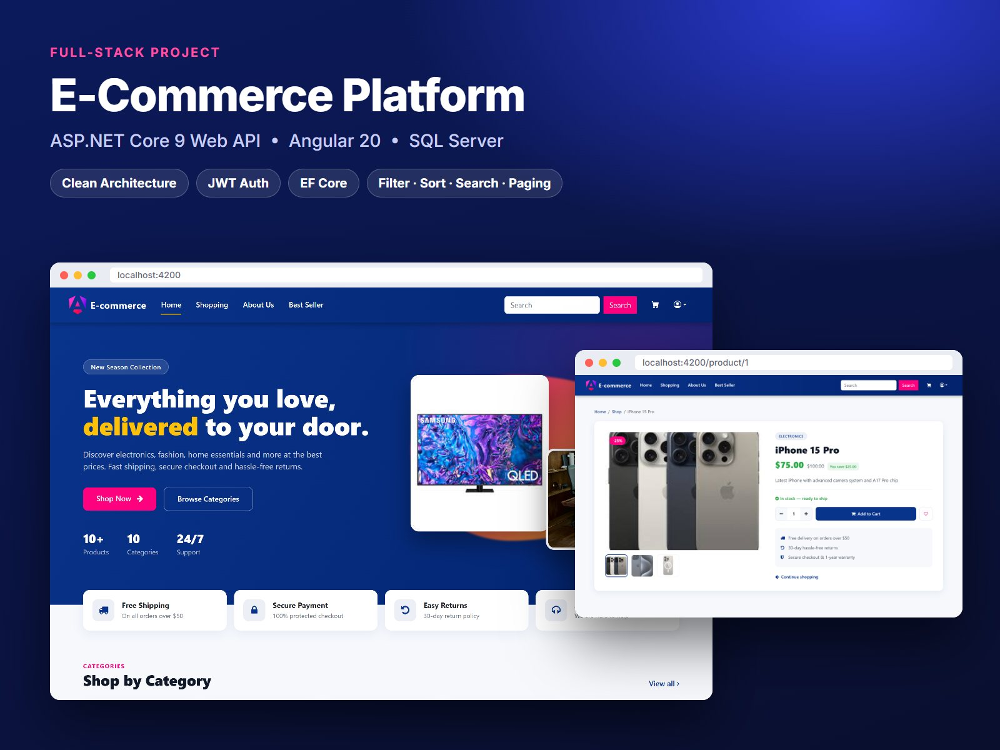
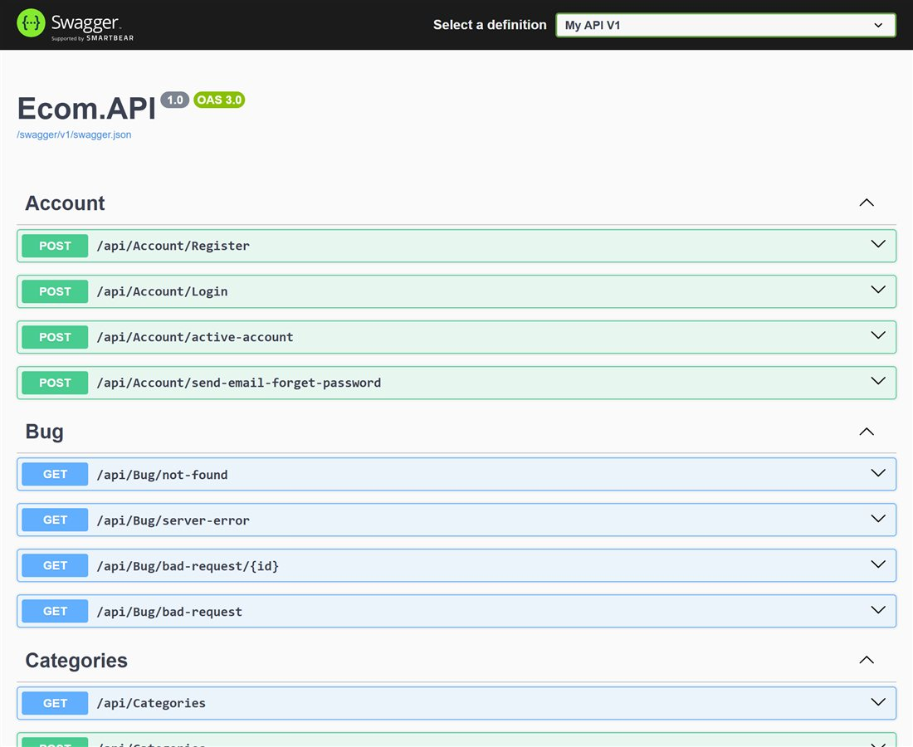

# E-Commerce API — ASP.NET Core 9

RESTful backend for a full-stack e-commerce store, built with **ASP.NET Core 9**, **Entity Framework Core** and **SQL Server** using a layered Clean Architecture.

**Frontend (Angular 20):** [HadyElMaageny/Econ-client](https://github.com/HadyElMaageny/Econ-client)



## Features

- **Products & categories:** full CRUD, with multi-image upload for products (files stored under `wwwroot/Images`)
- **Product search:** server-side filtering by category, keyword search across name and description, sorting (name / price asc / price desc) and pagination
- **Authentication:** ASP.NET Core Identity with JWT stored in an HttpOnly cookie, covering register, login, email confirmation and forgot/reset password emails
- **Consistent responses:** every endpoint returns a `ResponseAPI<T>` envelope, and paged endpoints return `Pagination<T>`
- **Cross-cutting middleware:** global exception handling, security headers and per-IP rate limiting
- **Seed data:** 10 categories, 10 products and 22 product photos are created by the migrations
- **Swagger UI** served at the app root in Development

## Architecture

```
Ecom.API             Controllers, middleware, AutoMapper profiles, response helpers
  └─ Ecom.Infrastructure   EF Core DbContext, migrations, repositories, Identity/JWT, email, image storage
       └─ Ecom.Core        Entities, DTOs, repository/service interfaces (no dependencies)
```

- **Repository + Unit of Work:** controllers depend only on `IUnitOfWork` and `IMapper`
- **Single composition root:** all DI, EF Core, Identity and auth configuration lives in `InfrastructureRegistration.cs`

## Tech stack

ASP.NET Core 9 · C# · Entity Framework Core 9 · SQL Server · ASP.NET Core Identity · JWT · AutoMapper · MailKit · Swagger

## Getting started

**Prerequisites:** [.NET 9 SDK](https://dotnet.microsoft.com/download/dotnet/9.0), SQL Server (LocalDB / Express / Developer) and the EF Core CLI (`dotnet tool install --global dotnet-ef`).

1. **Clone the repository**
   ```bash
   git clone https://github.com/HadyElMaageny/Ecom.git
   cd Ecom
   ```
2. **Set the connection string.** Edit `ConnectionStrings:EcomDatabase` in `Ecom.API/appsettings.json` if your SQL Server is not on `localhost,1433`.
3. **Create the database.** This applies all migrations and seed data:
   ```bash
   dotnet ef database update --project Ecom.Infrastructure --startup-project Ecom.API
   ```
4. **(Optional) Configure email.** Account confirmation and password reset send email over SMTP. Keep the password out of source control with user secrets:
   ```bash
   dotnet user-secrets set "EmailSettings:Password" "<your-smtp-app-password>" --project Ecom.API
   ```
5. **Run the API**
   ```bash
   dotnet run --project Ecom.API --launch-profile http
   ```
   Then open **http://localhost:5000** to browse Swagger UI.

> `Token:Secret` in `appsettings.json` is a development-only key. Use a strong secret (32+ characters) from user secrets or environment variables in any real deployment.

## API overview

| Area | Endpoints |
|---|---|
| Products | `GET /api/Products?CategoryId=&Search=&Sort=&PageNumber=&PageSize=` · `GET /api/Products/{id}` · `POST` · `PUT` · `DELETE /api/Products/{id}` |
| Categories | `GET /api/Categories` · `GET /api/Categories/{id}` · `POST` · `PUT` · `DELETE /api/Categories/{id}` |
| Account | `POST /api/Account/Register` · `POST /api/Account/Login` · `POST /api/Account/active-account` · `POST /api/Account/send-email-forget-password` |

`Sort` accepts `PriceAsc` or `PriceDesc`; any other value sorts by name. `PageSize` is capped at 6.


